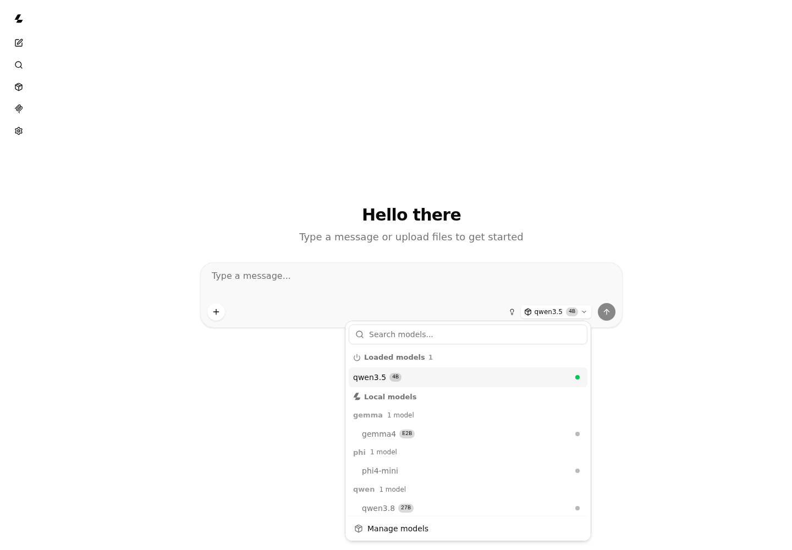

**Computational wind & atmospheric modelling · Scientific software · Reproducible workflows**

I develop modelling and scientific-computing tools spanning atmospheric simulation, wind energy, reproducible workflows and local AI.

My work combines numerical modelling, scientific Python and software engineering.
Atmospheric science and wind energy are important applications; the wider goal
is to make complex computational tools easier to run, inspect and reuse.

## Selected projects

| Project | What you can use it for | Engineering focus |
| --- | --- | --- |
| **[WRF_tools](https://github.com/adithyavemuri/WRF_tools)** | Analyse and visualise WRF/WRF-LES output, including turbulence and wind-energy diagnostics. | Scientific computing, diagnostics and visualisation |
| **[qwen-local](https://github.com/adithyavemuri/qwen-local)** | Download verified GGUF models and switch between Qwen, Gemma and Phi in a local browser. | Local AI deployment, model management and user-space setup |
| **[wrf-autocompiler](https://github.com/adithyavemuri/wrf-autocompiler)** | Build WRF-ARW/WPS with configurable build options and prerequisite checks, without root access. | Build automation and dependency management |
| **[wrf-era5-case](https://github.com/adithyavemuri/wrf-era5-case)** | Prepare ERA5 reanalysis inputs and readable WRF/WPS case configuration from TOML. | Data acquisition and reproducible simulation preparation |

These are public, reusable projects. Each repository documents its setup,
examples and limitations. For qwen-local, Linux operation is verified; Windows
compatibility scripts are provided but end-to-end runtime testing is deferred.

## In practice

### From model output to a scientific explanation

An example produced with **WRF_tools**: geographic context, a vertical section,
time-height evolution and wind profiles in one view. This is model output,
not observational validation.

### Local models, one browser

**qwen-local** handles verified downloads, runtime setup and installed-model
selection. The browser interface is provided by
[llama.cpp](https://github.com/ggml-org/llama.cpp). Models run locally, one at a
time; this is not an autonomous agent or a guarantee of answer correctness.

## Interests

- Turbulence, atmospheric flows and wind energy.
- Reproducible scientific computing and research software.
- Clear, useful scientific visualisation.
- Build automation, practical local AI and tools that make complex workflows usable.

## Connect

[LinkedIn](https://www.linkedin.com/in/adithyavemuri/) ·
[Explore my public repositories](https://github.com/adithyavemuri?tab=repositories)
