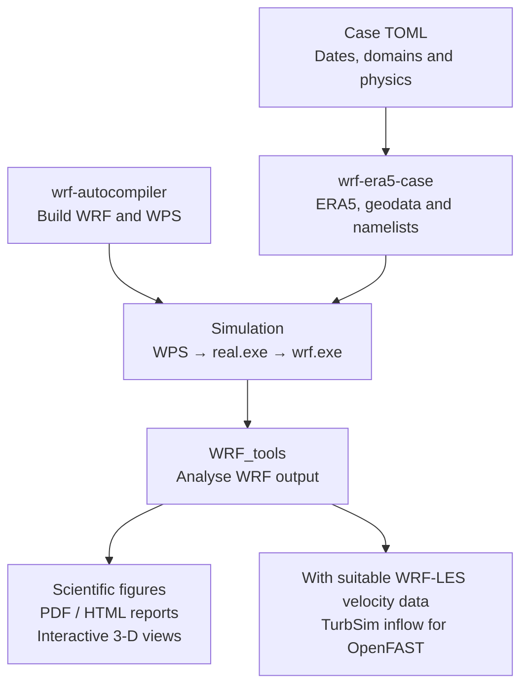

Atmospheric modelling, wind energy & Local AI models

**[WRF_tools](https://github.com/adithyavemuri/WRF_tools)** is the public entry
point: analyse existing WRF output, explore the diagnostics and see the results
without compiling or running a new simulation.

- **See the result:** [real-data demonstration PDF](https://github.com/adithyavemuri/WRF_tools/blob/main/example_results/final-report/hindcast-report.pdf).
- **Try it on your data:** [beginner examples](https://github.com/adithyavemuri/WRF_tools/blob/main/examples/README.md).
- **Prepare a simulation:** [TOML-driven ERA5 cases](https://github.com/adithyavemuri/wrf-era5-case) and [rootless WRF/WPS builds](https://github.com/adithyavemuri/wrf-autocompiler).
- **Run local coding models:** [LocalHarness](https://github.com/adithyavemuri/LocalHarness), previously named `qwen-local`.

## How the pieces fit together



The public packages are independent building blocks. A **private workflow
prototype** connects build, preparation, execution and reporting; the diagram
does not imply that the public packages alone provide a one-command runner.
WRF-LES inflow generation is a separate workflow requiring suitable temporal
sampling, velocity extraction and coordinate checks—not an automatic conversion
of an hourly mesoscale hindcast.

## Public building blocks

| Project | Role in the platform |
| --- | --- |
| **[wrf-autocompiler](https://github.com/adithyavemuri/wrf-autocompiler)** | Build WRF-ARW/WPS without root access, with configurable compiler, dependency and build-mode choices. |
| **[wrf-era5-case](https://github.com/adithyavemuri/wrf-era5-case)** | Download ERA5/geodata and generate readable WRF/WPS configuration from TOML, including stationary one-way nests. |
| **[WRF_tools](https://github.com/adithyavemuri/WRF_tools)** | Analyse WRF/WRF-LES output: meteorology, turbulence, wind energy, comparisons, visualisation, reports and TurbSim/OpenFAST inflow. |
| **[wrf-source-tools](https://github.com/adithyavemuri/wrf-source-tools)** | Inspect WRF Fortran interfaces, direct-call chains and selected assignments offline; support source-level investigation. |
| **[LocalHarness](https://github.com/adithyavemuri/LocalHarness)** | Set up local Qwen, Gemma and Phi models, with OpenCode, Cline support, shared skills and browser switching. Optional development support, not part of the numerical model. |

Each repository provides its own setup, examples and limitations. LocalHarness
has locally verified Linux operation; Windows compatibility is implemented but
not yet validated end to end. Local models do not replace scientific review.

## Short demonstration: WRF output → a scientific report

[](https://github.com/adithyavemuri/WRF_tools)

This **WRF_tools** figure combines a wind map, vertical section, time-height
evolution and profiles. The linked demonstration report uses a two-domain
Netherlands hindcast: 9 km and 3 km grids, 10 January 2025, 00–06 UTC.

To generate a report from your own output, clone `WRF_tools`, follow its
[installation guide](https://github.com/adithyavemuri/WRF_tools#installation),
then run from that repository:

```bash
python examples/create_hindcast_report.py /path/to/wrf/run \
  --domain d02 --diagnostics all --output reports/my-case
```

Open `reports/my-case/hindcast-report.pdf`. The report includes the domains
found in the run; `d02` selects the primary domain for this example. The same
workflow can be reused on another case rather than rewriting the analysis.

**Scientific boundary:** this is model-output analysis, not observational
validation or a bankable wind-resource assessment. The demonstration's hourly
output is not LES turbulence; unavailable diagnostics are identified explicitly.
See the [methods and references](https://github.com/adithyavemuri/WRF_tools/blob/main/docs/SCIENTIFIC_METHODS.md).

## Local AI alongside the modelling workflow

[](https://github.com/adithyavemuri/LocalHarness)

**LocalHarness** handles verified model downloads and local runtime/client setup.
OpenCode is the default coding client; Cline and the optional
[llama.cpp](https://github.com/ggml-org/llama.cpp) browser shown above are also
supported. Models run locally, one at a time. Coding actions depend on the
chosen client's permissions and still need human review.

## Interests

- Turbulence, atmospheric flows and wind energy.
- Reproducible scientific computing and research software.
- Clear, useful scientific visualisation.
- Build automation, practical local AI and tools that make complex workflows usable.

## Connect

[LinkedIn](https://www.linkedin.com/in/adithyavemuri/) ·
[Explore my public repositories](https://github.com/adithyavemuri?tab=repositories)
